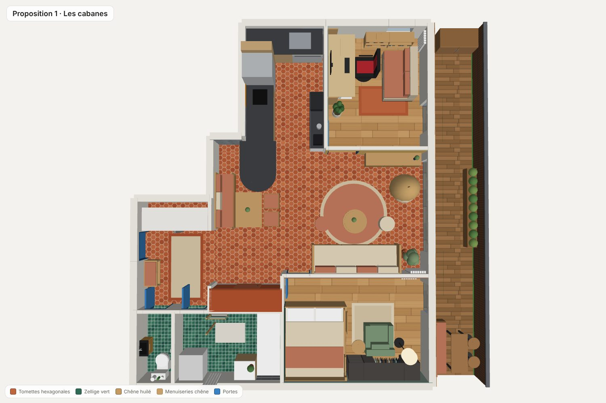
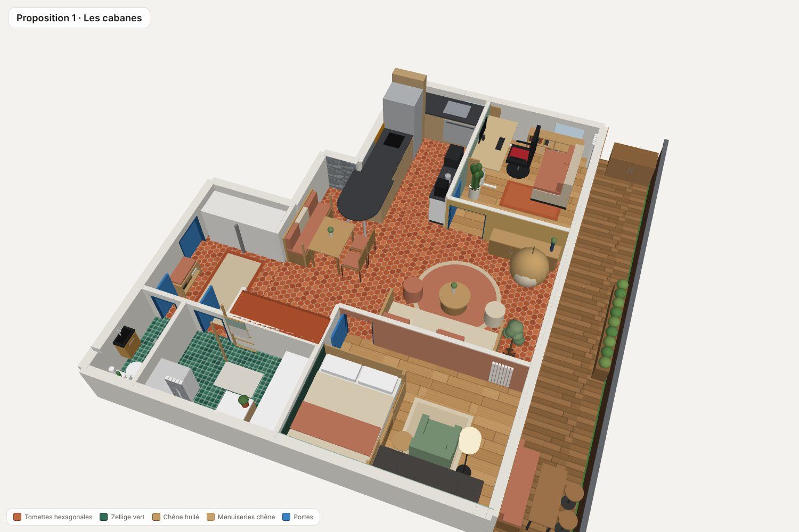
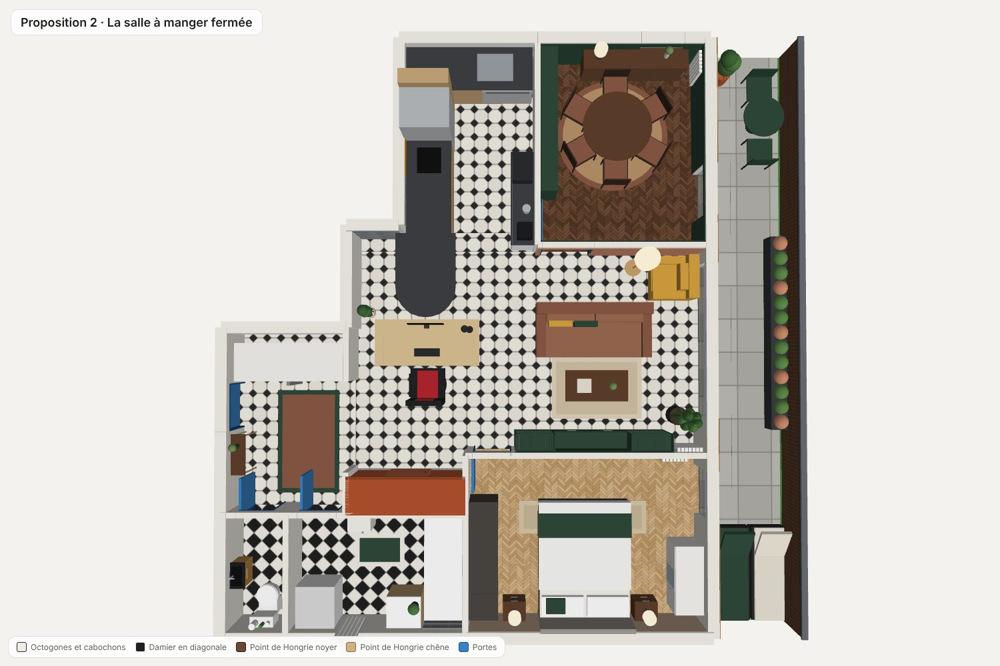
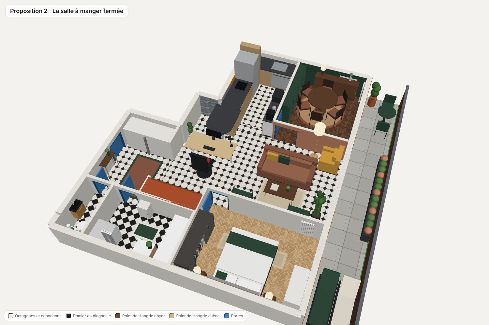
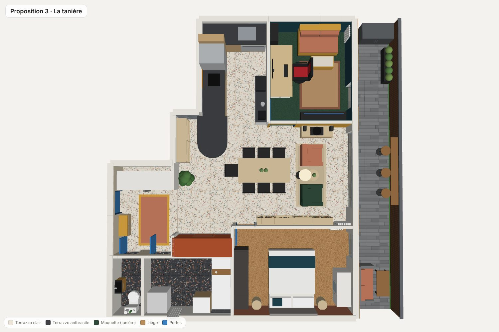
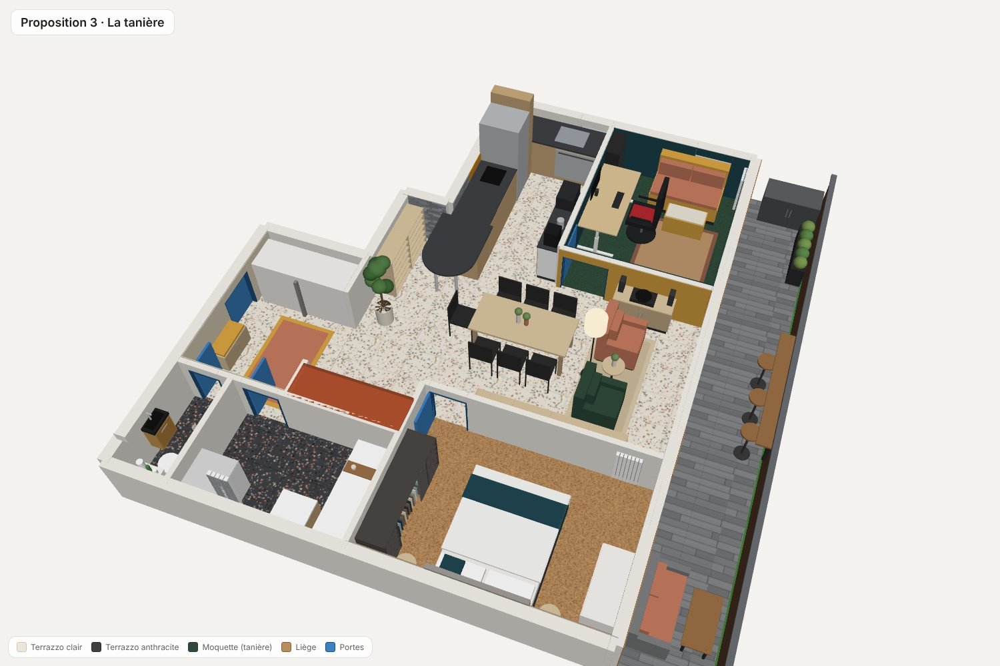
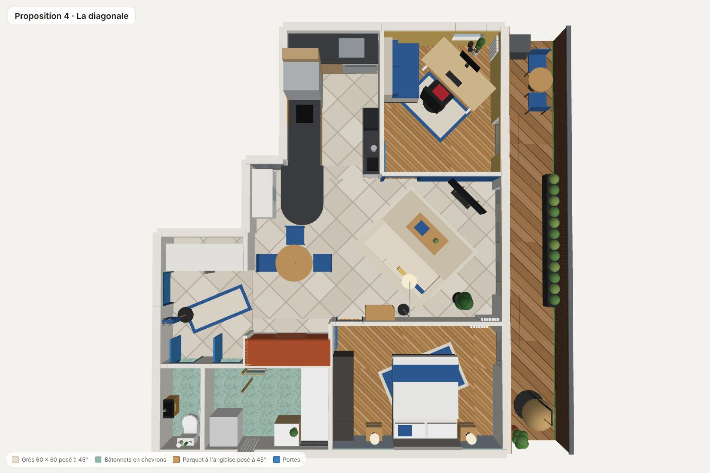
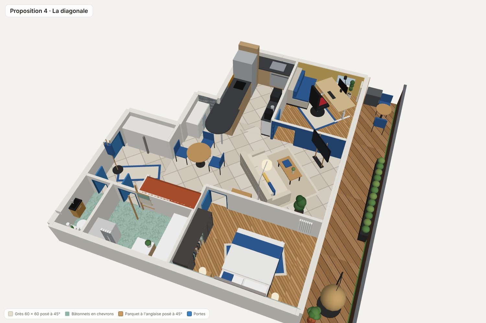
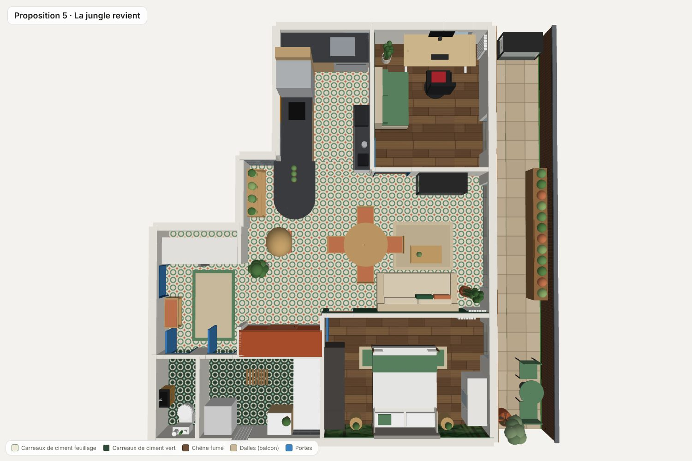
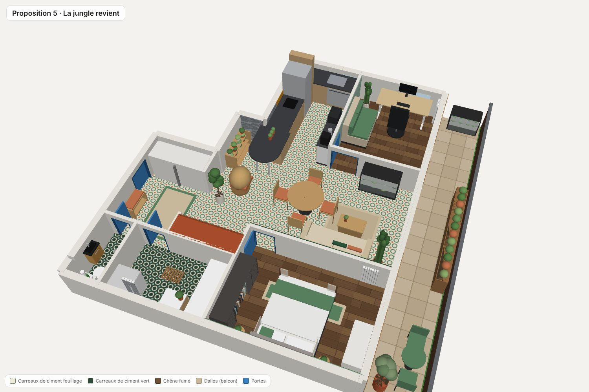

# Carte blanche : cinq façons d'habiter le T3

Ce dossier contient cinq propositions d'aménagement, toutes complètes, de la cuisine au balcon. Chacune part d'une idée différente : pour certaines, des pièces changent d'usage ; pour d'autres, ce sont des meubles sur mesure, une géométrie ou un thème qui portent le projet. Les règles fixes sont respectées partout : murs, ouvertures, portes, fenêtres, radiateurs, placard du couloir et cuisine sont inchangés ; les zones carrelées restent en carrelage ; les passages font au moins 80 cm (90 cm en cuisine) ; il y a au moins un couchage double.

| # | Nom | Le geste en une ligne |
|---|-----|-----------------------|
| 1 | **Les cabanes** | Le lit devient un lit clos en chêne, et chaque pièce reçoit son abri en bois (alcôve-canapé, banquette-cabane, niche de bureau, tonnelle). |
| 2 | **La salle à manger fermée** | La chambre 2, collée à la cuisine, devient une vraie salle à manger-bibliothèque ; le séjour devient un grand salon-bibliothèque avec un atelier. |
| 3 | **La tanière** | Tous les écrans partent dans la chambre 2 (cinéma, jeux, amis) ; le séjour, sans télé, devient une salle commune autour d'une table de ferme. |
| 4 | **La diagonale** | Le salon et le bureau pivotent à 45° pour suivre les vraies lignes de passage ; les sols sont posés en diagonale. |
| 5 | **La jungle revient** | La fresque jungle retirée revient en vrai : serre d'intérieur, plantes suspendues, papier peint panoramique, potager au balcon. |

Ouvrir `proposition-1.html` … `proposition-5.html` (même fonctionnement que `index.html`, three.js r128 via CDN) : boutons **Avant / Projet**, **Maquette / Murs complets** (meubles hauts, suspensions et TV visibles en murs complets), pièces, deux palettes de peinture et de textiles par proposition, et des liens 1–5 pour passer d'une proposition à l'autre.

---

## 1 · Les cabanes




**L'idée.** On se sent mieux dans une niche que dans une pièce ouverte : un lit clos breton, en chêne, avec des volets coulissants, transforme la chambre 1 en deux espaces (la boîte pour dormir, le reste en salon du matin), et le même principe s'applique au séjour, au bureau, à l'entrée et au balcon. Ça fonctionne parce que les cabanes servent aussi de rangements (tiroirs sous le lit clos et sous l'alcôve, niches à livres) et qu'elles laissent le centre des pièces libre.

**Usage des pièces.** Séjour : salon dans une alcôve, coin repas en banquette. Chambre 1 : lit clos et salon du matin. Chambre 2 : bureau-cabane et chambre d'amis. Balcon : coin repas sous tonnelle.

**Sols.** Séjour, cuisine et entrée en tomettes hexagonales en terre cuite (≈ 16 cm, joints sable). SDB et WC en zellige vert bouteille 10 × 10. Chambres en chêne massif huilé, lames larges. Balcon en lames de bois (caillebotis).

**Meubles par pièce**
- **Séjour**
  - Alcôve-canapé sur mesure, 250 × 80 × 220 cm, contre le mur de la chambre 1 : assise de 0,42 m avec 3 tiroirs, coussins en lin, étagère à livres et rubans LED dans le toit. Réalisation par un menuisier (contreplaqué de chêne).
  - Banquette-cabane 160 × 50 cm avec un fronton en forme de maison (2,40 m), et sa table en chêne 100 × 75. Avec les 2 chaises, le coin repas compte 4 places.
  - Table basse ronde Ø 70, deux poufs Ø 44, buffet TV en chêne 160 × 40 × 55, TV 55" au mur.
  - Fauteuil suspendu en rotin Ø 90, type « cocon ».
  - Olivier en pot de terre cuite. Suspension en papier au-dessus de la table.
- **Cuisine** : les 2 METOD/MAXIMERA et leurs meubles hauts restent en place.
- **Chambre 1**
  - Lit clos sur mesure, 208 × 176 × 225 cm, pour le matelas 160 × 200 existant. Il comprend 3 grands tiroirs, une niche à livres, deux liseuses, des volets coulissants et un intérieur peint (vert bouteille ou bleu nuit).
  - Dressing ouvert existant (2,00 × 0,50) contre le mur du fond.
  - Fauteuil de lecture 80 × 80, guéridon et lampadaire près de la porte-fenêtre.
- **Chambre 2**
  - Bureau existant (180 × 80) dans une niche-cabane en chêne de 197 cm : montants, 3 étagères et toit à deux pentes.
  - Siège gaming existant.
  - BZ existant, côté porte-fenêtre : il sert de couchage d'amis de 140.
  - Bibliothèque basse 140 × 30 × 60 sous la fenêtre.
- **Entrée** : banc-coffre à chaussures 76 × 38 surmonté d'un cadre-maison avec patères, tapis de couloir en terre cuite, lanterne.
- **SDB et WC** : échelle porte-serviettes en chêne, fougère, tapis de bain ; au WC, étagère en chêne à 1,45 m avec plante et livres.
- **Balcon**
  - Tonnelle en bois (1,90 × 1,19 m, 2,30 m de haut) avec guirlande, au bout côté chambre 1.
  - Banquette-coffre 150 × 45, table étroite 110 × 47, 2 tabourets.
  - Jardinière de 2,30 m le long du garde-corps, armoire de rangement 110 × 55 × 160.

**Passages mesurés** (largeur libre garantie, rectangle vérifié vide dans le code)

| Passage | Largeur |
|---|---|
| Entrée → porte de la chambre 1 | 116 cm |
| Porte d'entrée → séjour | 103 cm |
| Devant le bar | 84 cm |
| Porte de la chambre 2 → séjour | 105 cm |
| Accès à la baie | 80 cm |
| Cuisine | 98 cm |
| Chambre 1 : porte → lit clos | 83 cm |
| Chambre 1 : vers la porte-fenêtre | 88 cm |
| Chambre 2 : porte → porte-fenêtre | 99 cm |
| SDB | 106 cm |
| Balcon | 108 cm |

**Meubles existants.** Le matelas 160 × 200 passe dans le lit clos ; le sommier et la tête de lit capitonnée sont revendus. Le dressing reste en chambre 1. Le bureau, le siège gaming et le BZ vont en chambre 2. Les METOD restent en cuisine. **La BRIMNES est revendue** : les tiroirs du lit clos et ceux de l'alcôve la remplacent.

**Ce que ça sacrifie.** Le lit clos n'est accessible que par un côté : celui qui dort contre le mur enjambe l'autre. Il demande un vrai budget de menuiserie et il est difficile à déménager. Il n'y a que 4 places à table (6 en ajoutant les poufs).

**Budget indicatif** : 19 000 à 27 000 €.
- Sols : ≈ 8 500 €, dont 4 800 de tomettes posées, 1 400 de zellige et 2 300 de chêne massif.
- Menuiseries sur mesure : 8 000 à 13 000 €. Le lit clos compte pour 3 500 à 6 000 € et l'alcôve pour 2 500 à 4 000 €.
- Mobilier, balcon, textiles, plantes et peinture : 2 500 à 5 500 €.

---

## 2 · La salle à manger fermée




**L'idée.** La porte de la chambre 2 est juste à côté de l'entrée de la cuisine : c'est la place naturelle d'une vraie salle à manger fermée, entourée de livres, avec une porte-fenêtre pour dîner dehors l'été. Libéré de la table, le séjour de 28 m² devient un grand salon-bibliothèque avec une échelle coulissante, plus un atelier près de l'entrée.

**Usage des pièces.** Chambre 2 : salle à manger-bibliothèque (6 places). Séjour : salon et atelier (bureau). Chambre 1 : chambre. Balcon : bistrot côté salle à manger et bains de soleil côté chambre.

**Sols.** Séjour et entrée en octogones blancs et cabochons noirs (grès cérame). SDB et WC en damier noir et blanc posé en diagonale. Salle à manger en point de Hongrie noyer. Chambre 1 en point de Hongrie chêne clair. Balcon en dalles de grès gris.

**Meubles par pièce**
- **Séjour**
  - Bibliothèque murale de 268 × 30 × 240 cm contre le mur de la chambre 1, laquée de la couleur des murs de la salle à manger. Elle intègre un caisson bas à 2 tiroirs, une TV dans une niche et une **échelle coulissante sur rail laiton**. Réalisation type IKEA BILLY ou PLATSA habillé, rail de bibliothèque en kit.
  - Canapé convertible 200 × 95 en velours, couchage d'amis, face à la bibliothèque.
  - Table basse en noyer et laiton 110 × 55, fauteuil de lecture 75 × 75, lampadaire laiton, strelitzia.
  - Atelier : bureau existant 180 × 80 posé librement face au bar, siège gaming existant, lampe d'architecte, panneau perforé, suspension.
- **Cuisine** : les METOD restent en place.
- **Salle à manger (ch. 2)**
  - Bibliothèque de 250 × 30 × 230 sur le mur de la cuisine, buffet en noyer 180 × 35 × 80 sous la fenêtre.
  - Table ronde en noyer Ø 120 et 6 chaises, tapis rond Ø 200, lustre en laiton, miroir doré.
- **Chambre 1** (disposition validée, revue)
  - Dressing existant à l'ouest, BRIMNES à l'est (décalée sous le rideau), lit 160 × 200 tête au fond.
  - Tables de nuit en noyer 40 × 35 avec lampes.
- **Entrée** : console en noyer et laiton 70 × 25, miroir rond, tapis, suspension laiton.
- **SDB et WC** : colonne blanche 40 × 30 × 160, tapis, plante ; au WC, étagère et cadre.
- **Balcon**
  - Côté salle à manger : table bistrot Ø 70 et 2 chaises.
  - Jardinières de 3,40 m le long du garde-corps.
  - 2 bains de soleil au bout côté chambre 1.

**Passages mesurés**

| Passage | Largeur |
|---|---|
| Entrée → porte de la chambre 1 | 80 cm |
| Porte d'entrée → séjour | 103 cm |
| Devant le bar | 84 cm |
| Porte de la salle à manger → séjour | 88 cm |
| Accès à la baie | 80 cm |
| Cuisine | 98 cm |
| Accès à la bibliothèque | 81 cm |
| Salle à manger : porte → porte-fenêtre | 96 cm |
| Chambre 1 : porte → porte-fenêtre | 83 cm |
| Chambre 1 : ruelles du lit | 71 et 71 cm |
| SDB | 106 cm |
| Balcon | 108 cm |

**Meubles existants.** Lit, dressing et BRIMNES restent en chambre 1. Le bureau et le siège gaming vont dans l'atelier du séjour. Les METOD restent en cuisine. **Le BZ est revendu** : le canapé convertible prend le rôle de couchage d'amis.

**Ce que ça sacrifie.** Il n'y a plus de chambre d'amis fermée : les amis dorment au salon. Le bureau est dans la pièce de vie. La salle à manger ne sert qu'aux repas, et c'est un choix de mode de vie.

**Budget indicatif** : 13 000 à 21 000 €.
- Sols : ≈ 6 500 €.
- Bibliothèque murale et échelle : 1 500 € (en kit) à 6 000 € (sur mesure).
- Salle à manger : 2 500 à 5 000 €.
- Canapé convertible : 1 200 à 2 000 €.
- Reste du mobilier, balcon et peinture : 1 500 à 2 500 €.

---

## 3 · La tanière




**L'idée.** On enferme les écrans au lieu de les mettre au centre : la chambre 2 devient une tanière sombre (murs bleu pétrole, moquette, grande TV, console, BZ pour les amis), et le séjour, sans télé, redevient une salle commune autour d'une grande table, avec un coin lecture face à la baie et un meuble à disques. Les soirées film ou jeux se passent à huis clos sans déranger le reste de l'appartement, et la pièce la plus lumineuse sert à manger, lire et recevoir.

**Usage des pièces.** Séjour : salle commune (table de 7 places, coin lecture, musique). Chambre 2 : tanière (cinéma, jeux, bureau, couchage d'amis). Chambre 1 : chambre. Balcon : comptoir-belvédère et petit salon.

**Sols.** Séjour et entrée en terrazzo clair 60 × 60 (grès cérame aspect terrazzo). SDB et WC en terrazzo anthracite. Tanière en moquette bouclée vert forêt (acoustique). Chambre 1 en liège naturel. Balcon en lames composites grises.

**Meubles par pièce**
- **Séjour**
  - Table de ferme en frêne 180 × 85, 7 chaises noires (3 + 3 + 1 en bout), suspension linéaire de 150 cm.
  - Coin lecture face à la baie : 2 fauteuils 75 × 75 tournés vers le balcon, guéridon, lampadaire, tapis.
  - Meuble à disques 110 × 42 × 62 avec platine et enceintes.
  - Galerie basse 260 × 25 × 90 contre le mur de la chambre 1, avec des cadres au-dessus.
  - Grande bibliothèque 150 × 35 × 220 contre le mur ouest, ficus lyrata.
- **Cuisine** : les METOD restent en place.
- **Tanière (ch. 2)**
  - Bureau existant contre le mur de la cuisine, avec 3 étagères au-dessus ; siège gaming existant.
  - Colonne de jeux et films 65 × 30 × 230.
  - BZ existant sous la fenêtre, face à une TV 65" murale ; meuble TV 160 × 40 avec bandeau LED.
  - Pouf-coffre 80 × 40, applique néon.
- **Chambre 1**
  - Disposition validée : dressing, BRIMNES et lit.
  - Grand panneau textile au-dessus de la tête de lit, avec 2 appliques ; chevets ronds en frêne.
- **Entrée** : banc à chaussures 76 × 35 avec coussin, barre de patères, tapis ocre, suspension.
- **SDB et WC** : pont de baignoire en teck, plante suspendue au-dessus de la baignoire ; au WC, étagère.
- **Balcon**
  - Comptoir-belvédère de 230 × 25 accroché au garde-corps, à 1,05 m, devant la baie, avec 3 tabourets hauts.
  - Canapé d'extérieur 2 places et table basse au bout côté chambre 1.
  - Rangement et jardinière au bout côté chambre 2.

**Passages mesurés**

| Passage | Largeur |
|---|---|
| Entrée → porte de la chambre 1 | 80 cm |
| Porte d'entrée → séjour | 103 cm |
| Devant le bar | 84 cm |
| Porte de la tanière → séjour | 80 cm |
| Accès à la baie | 80 cm |
| Table ↔ galerie basse | 84 cm |
| Cuisine | 98 cm |
| Tanière : porte → porte-fenêtre | 104 cm |
| Chambre 1 : porte → porte-fenêtre | 83 cm |
| Chambre 1 : ruelles du lit | 71 et 71 cm |
| SDB | 106 cm |
| Balcon | 86 cm |

**Meubles existants.** Tous sont gardés. Lit, dressing et BRIMNES restent en chambre 1. Bureau, siège gaming et BZ vont dans la tanière. Les METOD restent en cuisine.

**Ce que ça sacrifie.** Plus de télé « en passant » dans le séjour. La tanière est sombre, ce qui est voulu, mais l'éclairage doit être bien pensé pour y travailler. Quand on reçoit, les invités dorment dans la pièce des écrans.

**Budget indicatif** : 12 000 à 18 000 €.
- Sols : ≈ 5 400 €.
- Séjour : 3 500 à 6 500 €.
- Tanière, TV comprise : 1 500 à 2 500 €.
- Balcon : 900 à 1 500 €.
- Peinture et décoration : 800 à 1 500 €.

---

## 4 · La diagonale




**L'idée.** Dans ce séjour, on ne circule jamais parallèlement aux murs : on va en biais, de l'entrée vers la baie et de la chambre 2 vers la chambre 1. Le salon tourne donc à 45°, avec son canapé face à l'angle de la baie et sa TV sur un chevalet. Ce pivot libère deux triangles de passage et dégage la vue sur le balcon. Le bureau de la chambre 2 se cale de même dans l'angle de la fenêtre, et les sols posés en diagonale prolongent ce mouvement.

**Usage des pièces.** Séjour : salon à 45°, coin repas pour 3 près du bar. Chambre 2 : bureau d'angle et couchage d'amis. Chambre 1 : chambre. Balcon : bistrot et fauteuil œuf.

**Sols.** Séjour et entrée en grès 60 × 60 grège **posé à 45°**. SDB et WC en bâtonnets vert d'eau en chevrons. Chambres en parquet à l'anglaise posé à 45°. Balcon en lames de bois posées à 45°.

**Meubles par pièce**
- **Séjour**
  - Canapé 220 × 95 pivoté à 45°, sur un tapis 240 × 170 lui aussi pivoté.
  - Table basse 100 × 50 à 45°, TV 50" sur chevalet en bois (type « easel stand ») dans l'angle nord-est.
  - Lampadaire arc au-dessus du canapé, bibliothèque étroite 70 × 30 × 190, monstera.
  - Coin repas : table ronde Ø 90, 3 chaises (une 4e pliante en appoint) et suspension. La BRIMNES y sert d'armoire à linge et à vaisselle.
- **Cuisine** : les METOD restent en place.
- **Chambre 2**
  - Bureau existant 180 × 80 posé en diagonale dans l'angle de la fenêtre, siège gaming en face.
  - Plante et lampe dans le triangle derrière le bureau.
  - BZ existant contre le mur de la cuisine, étagère murale, tapis à 45°.
- **Chambre 1**
  - Dressing à l'ouest ; lit 160 × 200 recentré entre le dressing et la façade (sans la BRIMNES), avec des ruelles de 96 et 89 cm.
  - Tables de nuit en chêne, tapis légèrement pivoté.
- **Entrée** : portemanteau sur pied, tapis pivoté, suspension.
- **SDB et WC** : échelle porte-serviettes, plante ; au WC, étagère.
- **Balcon** : table Ø 60 et 2 chaises côté chambre 2, jardinière de 3,30 m, fauteuil œuf sur pied Ø 90 et agrumes côté chambre 1, petit rangement.

**Passages mesurés**

| Passage | Largeur |
|---|---|
| Entrée → porte de la chambre 1 | 80 cm |
| Porte d'entrée → séjour | 103 cm |
| Devant le bar | 84 cm |
| Porte de la chambre 2 → séjour | 88 cm |
| Accès à la baie | 80 cm |
| Cuisine | 98 cm |
| Chambre 2 : porte → porte-fenêtre | 97 cm |
| Chambre 1 : porte → porte-fenêtre | 83 cm |
| Chambre 1 : ruelles du lit | 96 et 89 cm |
| SDB | 106 cm |
| Balcon | 108 cm |

**Meubles existants.** Tous sont gardés. La BRIMNES passe au séjour comme armoire du coin repas. Le dressing et le lit restent en chambre 1. Bureau, siège gaming et BZ vont en chambre 2. Les METOD restent en cuisine.

**Ce que ça sacrifie.** Le coin repas n'a que 3 places, plus une chaise d'appoint. Les meubles en biais laissent des triangles, utilisés ici pour des plantes et des lampes. La pose en diagonale coûte environ 10 à 15 % de plus, à cause des chutes et du temps de pose. La TV est petite pour la distance (50").

**Budget indicatif** : 10 000 à 15 000 €.
- Sols : ≈ 7 300 €.
- Mobilier : 2 500 à 5 500 €.
- Balcon et décoration : 600 à 1 500 €.

---

## 5 · La jungle revient




**L'idée.** La fresque jungle effacée par les travaux revient, mais vivante : une serre d'intérieur éclairée tient la place de la télé face au canapé, des plantes sont suspendues sur un rail devant la baie, les sols sont en carreaux de ciment à motif feuillage, le lit a un baldaquin de lin et un papier peint panoramique jungle, et le balcon devient un potager. L'appartement est traversant, avec une baie de 2,65 m plein est sur le balcon : les plantes y ont la lumière, et elles absorbent le bruit et la sécheresse de l'air que les grands sols durs accentuent.

**Usage des pièces.** Séjour : jardin d'hiver (salon, table ronde, coin orangerie). Chambre 2 : bureau des plantes et couchage d'amis. Chambre 1 : chambre à baldaquin. Balcon : potager et bistrot.

**Sols.** Séjour et entrée en carreaux de ciment 20 × 20 à motif feuillage vert et terracotta sur fond crème. SDB et WC en carreaux de ciment vert sapin et crème. Chambres en chêne fumé. Balcon en dalles beige.

**Meubles par pièce**
- **Séjour**
  - Canapé en lin 200 × 95 contre le mur de la chambre 1, face à la **serre d'intérieur**. La serre est une vitrine de 120 × 50 × 190 à 3 étagères avec rampe LED horticole (type IKEA MILSBO ou RUDSTA et lampe de culture).
  - Table basse en rotin 80 × 45, strelitzia de 1,90 m.
  - Rail à plantes devant la baie avec 4 suspensions à 2,20 m.
  - Table ronde en chêne Ø 110, 4 chaises en rotin, suspension en rotin.
  - Coin orangerie : étagère à plantes en gradins 120 × 40 × 140, fauteuil rotin, ficus. Herbes aromatiques sur le bar.
- **Cuisine** : les METOD restent en place.
- **Chambre 1**
  - Lit existant habillé d'un **baldaquin** : 4 montants en chêne fumé et voilages de lin.
  - Papier peint panoramique jungle derrière la tête de lit (palette « Jungle »).
  - Dressing et BRIMNES conservés, chevets en rotin avec plantes.
- **Chambre 2**
  - Bureau existant sous la fenêtre (lumière de face), 2 plantes suspendues devant la vitre, siège gaming.
  - BZ contre le mur de la cuisine, étagère au-dessus avec livres et plantes.
- **Entrée** : banc à chaussures, **mur végétal** en mousse stabilisée de 76 × 110 (sans arrosage), tapis vert, suspension en rotin.
- **SDB et WC** : caillebotis en teck, fougère, 2 plantes suspendues au-dessus de la baignoire ; au WC, étagère avec 3 plantes.
- **Balcon**
  - Carrés potagers de 330 × 35 × 70 le long du garde-corps.
  - Treillis avec grimpantes sur la façade entre la chambre 2 et la baie.
  - Mini-serre 100 × 50 × 160 au bout côté chambre 2.
  - Table bistrot, 2 chaises et olivier au bout côté chambre 1.

**Passages mesurés**

| Passage | Largeur |
|---|---|
| Entrée → porte de la chambre 1 | 80 cm |
| Porte d'entrée → séjour | 103 cm |
| Devant le bar | 84 cm |
| Porte de la chambre 2 → séjour | 80 cm |
| Accès à la baie | 80 cm |
| Cuisine | 98 cm |
| Chambre 2 : porte → porte-fenêtre | 140 cm |
| Chambre 1 : porte → porte-fenêtre | 82 cm |
| Chambre 1 : ruelles du lit, entre les montants du baldaquin | 66 et 66 cm |
| SDB | 106 cm |
| Balcon | 87 cm |

**Meubles existants.** Tous sont gardés. Lit (avec le baldaquin ajouté), dressing et BRIMNES restent en chambre 1. Bureau, siège gaming et BZ vont en chambre 2. Les METOD restent en cuisine.

**Ce que ça sacrifie.** Les plantes demandent de l'entretien : arrosage, rempotage, et quelqu'un pour s'en occuper pendant les vacances. Il n'y a pas de TV dans le séjour (la TV peut aller en chambre 2 au-dessus du BZ). Les carreaux de ciment se tachent : il faut les imprégner et les entretenir. Les montants du baldaquin réduisent les ruelles à 66 cm.

**Budget indicatif** : 14 000 à 20 000 €.
- Sols : ≈ 9 000 €. Les vrais carreaux de ciment posés reviennent à environ 170 €/m² ; une imitation en grès cérame ferait économiser environ 2 500 €.
- Mobilier : 3 500 à 6 000 €.
- Plantes, serre, rail, potager et papier peint : 1 500 à 3 000 €.

---

## Vérification

`outils/check.js` (playwright + chromium, three.js r128 chargé en local) ouvre chaque proposition et contrôle les points suivants :

1. **Erreurs JS** : aucune, en mode Projet, sur chacune des deux palettes et après un aller-retour Avant / Projet.
2. **Chevauchements** : chaque élément de mobilier est nommé (`it('nom', …)`), et chaque pièce de chaque meuble est testée en 3D (boîtes orientées, test SAT, tolérance 1,2 cm) contre :
   - les murs, portes, encadrements, vitrages et placards ;
   - les équipements fixes : cuisine, bar, sanitaires, radiateurs, rideaux, garde-corps ;
   - les zones à garder libres : débattement de toutes les portes battantes (entrée, WC, SDB, chambres 1 et 2), 80 cm devant chaque porte-fenêtre des chambres, côté intérieur comme côté balcon, devant les façades du placard du couloir et du placard d'entrée, devant les trois radiateurs, et lave-vaisselle ouvert ;
   - tous les autres meubles.
   
   Les tapis, posés au sol, sont exclus.
3. **Passages** : chaque passage est un rectangle (entre 0,05 et 1,90 m de haut) qui doit être vide de tout objet. La largeur indiquée est sa petite dimension. Minimum 80 cm (90 cm en cuisine). Les ruelles de lit sont tenues à 60 cm, comme dans la disposition validée.

Le résultat (« Tout est vérifié. ») et le détail sont dans `outils/rapport.json`. Il y a 7 captures par proposition dans `captures/` : `pN-dessus`, `pN-perspective`, puis séjour, chambre 1, chambre 2, entrée et balcon, en vue maquette.

```bash
cd variantes/carte-blanche
node outils/build.js
```

```bash
npm i three@0.128.0 playwright && node outils/check.js
```

`node outils/check.js 2 4` ne vérifie que les propositions 2 et 4 ; `--sans-captures` saute les captures.

## Organisation

- `source/lib.js` : bibliothèque commune. Elle contient les meubles en repère local (`A()`, `AC()`, `A3()` pour séparer bas, haut et très haut), les meubles existants modélisés à leurs cotes (dressing, BRIMNES, lit, bureau, siège gaming, BZ, METOD), les textures de sol (hexagones, losanges, point de Hongrie, bandes à 45°, bruit), la peinture de murs entiers ou en papier peint, et la déclaration des passages et des zones.
- `source/p1.js` … `p5.js` : une proposition chacun, avec ses textures, ses palettes, ses étiquettes et `amenagement()`.
- `source/propositions.json` : noms, palettes et légendes.
- `outils/build.js` : copie `index.html` et y remplace uniquement l'ameublement, les sols et la décoration du mode Projet, ainsi que les palettes et la légende. Il ajoute la barre de navigation 1–5. Le mode Avant, les murs, la cuisine et les équipements ne changent pas.
- `proposition-N.html` : les fichiers générés, autonomes.

## Limites connues

- Les cotes du plan sont approximatives (cuisine, rideaux, profondeur du balcon ≈ 1,39 m) : un passage annoncé à 80 cm est à re-mesurer sur place.
- Les budgets sont des ordres de grandeur en France, fourniture et pose (sols posés, menuiserie d'agenceur), hors dépose de l'existant et hors électricité.
- Les « modèles réels » sont des indications de type, à vérifier en magasin.
